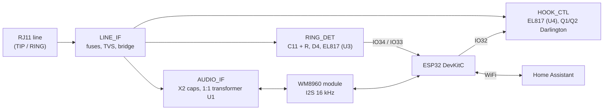

# Hardware and firmware: how the circuit and the firmware work

This folder holds the schematic and the PCB of the gateway (EasyEDA files and exports). This document explains **what the circuit does, block by block**, and **how the ESPHome firmware uses it**. The schematic and PCB files are the source of truth for part values and footprints; where this text quotes a value, it is the value used on the author's board (revision C plus the changes found during bring-up, see [Revision history](#revision-history)).

> **Safety.** The line side of the circuit is connected to the building intercom line, which carries a ring signal of tens of volts (about 45-48 V DC was read on a multimeter during a ring; the vendor states 75-120 V AC at about 27 Hz). Build, probe and test with care. Never connect the line side and the logic side to the same ground, and never touch the board while it is on the line.

Contents

1. [Overview](#1-overview)
2. [Electrical circuit](#2-electrical-circuit)
   - [2.1 Two ground domains](#21-two-ground-domains)
   - [2.2 LINE_IF: line input and protection](#22-line_if-line-input-and-protection)
   - [2.3 RING_DET: ring detector](#23-ring_det-ring-detector)
   - [2.4 HOOK_CTL: off-hook switch](#24-hook_ctl-off-hook-switch)
   - [2.5 AUDIO_IF: voice path](#25-audio_if-voice-path)
   - [2.6 WM8960 codec module](#26-wm8960-codec-module)
   - [2.7 ESP32 and power](#27-esp32-and-power)
   - [2.8 Pin map](#28-pin-map)
3. [Firmware](#3-firmware)
   - [3.1 Structure and boot](#31-structure-and-boot)
   - [3.2 Codec initialisation and levels](#32-codec-initialisation-and-levels)
   - [3.3 Ring detection](#33-ring-detection)
   - [3.4 Hook control, answer, hang up, watchdog](#34-hook-control-answer-hang-up-watchdog)
   - [3.5 Listening, push-to-talk and the audio stream](#35-listening-push-to-talk-and-the-audio-stream)
   - [3.6 Dialing: pulse and DTMF](#36-dialing-pulse-and-dtmf)
   - [3.7 Home Assistant entities and actions](#37-home-assistant-entities-and-actions)
4. [Measured behaviour on the real line](#4-measured-behaviour-on-the-real-line)
5. [Bring-up and troubleshooting](#5-bring-up-and-troubleshooting)
6. [Revision history](#revision-history)

---

## 1. Overview

The gateway is a **2-wire FXO interface** built from discrete parts. It makes the interior post's line look, to the Resel central unit, like a telephone:

- it can **see the ring** (a high voltage appears on the line);
- it can **lift the receiver** (draw loop current, so the line voltage drops to about 8 V);
- it can **send and receive voice** through a 1:1 isolation transformer;
- it can **dial** by briefly opening the loop (pulse) or by sending DTMF tones.



Left of the dashed barrier on the PCB is the **line side** (`LINE_GND`), right of it is the **logic side** (`GND`). Only three parts cross the barrier: the two optocouplers U3 and U4 and the audio transformer U1.

---

## 2. Electrical circuit

### 2.1 Two ground domains

| Net | Meaning |
|---|---|
| `LINE_GND` | Reference of the line side. Floating relative to the building and to the logic side. |
| `GND` | Reference of the ESP32, the codec and the USB supply. |

The two grounds are **never connected**. The barrier is crossed only by:

- **U3** (EL817C): ring detector, line to logic;
- **U4** (EL817C): hook control, logic to line;
- **U1** (SM-LP-5001): audio transformer, both directions.

The layout keeps at least 4 mm of clearance across the barrier. Check this again in the final layout before applying power.

### 2.2 LINE_IF: line input and protection

```
RJ1 pin 2 (TIP) --- F1 200 mA --+--- TIP_F  ---+
                                |              |  D2 P6KE250CA (bidirectional)
RJ1 pin 3 (RING) -- F2 200 mA --+--- RING_F ---+
                                |
              D3 KBP206G bridge (AC pads on TIP_F / RING_F)
                  + -> VLINE_RECT      - -> LINE_GND
                  C10 10 nF 1 kV  VLINE_RECT -> LINE_GND
```

- **F1, F2** (200 mA, 250 V): fuses in both wires.
- **D2** (P6KE250CA, bidirectional TVS): clamps surges between the two wires.
- **D3** (KBP206G): full-wave bridge. The gateway works with **either polarity** on the line. All of the circuits below hang on `VLINE_RECT` (positive) and `LINE_GND` (negative).
- **C10** (10 nF, 1 kV): high-frequency bypass.

### 2.3 RING_DET: ring detector

The ring detector turns the line voltage into a logic level for the ESP32, with galvanic isolation. It is a one-way path: `VLINE_RECT` → capacitor → LED of U3 → phototransistor → pins of the ESP32.

```
 line side (LINE_GND)                                         logic side (GND)

 VLINE_RECT ---C11 470 nF X2--+--- R10 4.7k --- D4 (P6KE33A) --- U3 pin1 (LED anode)
                |             |    ^ band (K) toward R10          U3 pin2 (LED K) = LINE_GND
          R1k (parallel       |                                   U6 BAV21: LED protection,
          with C11)           +-- R8 1M -- R9 1M -- LINE_GND      anti-parallel across the LED

                                                    3V3 --- U3 pin4 (collector)
                                                    U3 pin3 (emitter) = RD_E
 RD_E ---- R33 15k ---- GND                 (pull-down, idle level 0 V)
 RD_E ---- R34 1k  ---- IO33  (RING_PULSE)  (raw pulses, diagnostic)
 RD_E ---- R11 22k --- D9 BAT85 --- RING_DET (IO34) ---+--- C12 470 nF 63 V film --- GND
                                                       +--- R12 3 M --------------- GND
```

How it works:

1. **C11 (470 nF X2) and the 1 kΩ in parallel with it.** C11 couples the changes of the line voltage; the parallel resistor also lets a **steady voltage** through. During a ring the Resel line sits at a high voltage for the duration of the ring, so a capacitor alone only passed the first edge (this was the original fault, see [revision history](#revision-history)).
2. **R10 (4.7 kΩ) and D4 (P6KE33A TVS) set the threshold.** D4 sits in the LED path with its band (cathode) toward R10, so it works in reverse breakdown: nothing flows until the voltage across it exceeds its breakdown voltage (31.4-34.7 V). The line idles at about 3 V and sits at about 8 V when off hook, so the LED stays **off**. During a ring the line reaches about 45-48 V, so the LED conducts.
   An approximation of the LED current: `I ≈ (V_line − 1.4 V bridge − V_D4 − 1.2 V LED) / (R_parallel + R10)`. At 46 V with 1 kΩ: about 1.8 mA, enough to saturate the output (R33 is only 15 kΩ).
   With a 24 V TVS the threshold was too low: short impulses on the line in standby (about every 1.5-2 s, up to about 1.2 V on the node) got through. With the 33 V part the node is stable in standby.
3. **R8, R9 (2 × 1 MΩ)** bleed any charge from the coupling node so that it returns to 0 V after a ring.
4. **U6 (BAV21)** is placed anti-parallel across the LED, so reverse voltage on the LED stays below about 0.7 V.
5. **U3 output.** The phototransistor collector is on `3V3`, its emitter drives `RD_E`. With the LED off, **R33 (15 kΩ)** pulls `RD_E` to 0 V (this removed the drifting idle level of the first version). With the LED on, `RD_E` rises to about 3 V.
6. **R34 (1 kΩ)** takes `RD_E` to **IO33** unchanged: IO33 shows the **individual ring pulses/bursts** (a diagnostic input).
7. **R11 (22 kΩ) and D9 (BAT85)** feed **RING_DET (IO34)** through a peak-hold: D9 lets `C12 (470 nF, 63 V film)` charge fast and R12 (3 MΩ) discharges it slowly (time constant about 1.4 s). So between the bursts of one ring the node stays up for a moment. The same node is read by the ESP32's ADC.

A real ring on the author's line (idle 0.15 V on the ADC, which includes its offset):

- `RING_DET` rises to **3.1 V** (the clipping value of the ADC at 12 dB attenuation) on every burst of the ring, with bursts about 3 s apart, then decays below 1 V in about 2 s;
- **IO33** goes high on every burst.

### 2.4 HOOK_CTL: off-hook switch

```
 logic side                                                   line side

 3V3 -- R13 270R -- U4 pin1 (A)
 IO32 -- R14 1k -- Q5 base (2N3904);  R15 10k base -> GND   U4 pin2 (K) <- Q5 collector, Q5 emitter = GND

                                  VLINE_RECT -- R20 15k -- U4 pin4 (collector)
                                  U4 pin3 (emitter) -> Q1 base (MPSA42);  R21 47k Q1 base -> LINE_GND
                                  Q1 emitter -> Q2 base (MPSA42);        R22 47k Q2 base -> LINE_GND
                                  Q1 and Q2 collectors (HOLD_C) -- R19 300R 2 W -- VLINE_RECT
                                  Q2 emitter = LINE_GND
```

1. When **IO32 goes high**, Q5 conducts and the LED of U4 lights (about 7 mA through R13, 270 Ω).
2. U4's phototransistor passes current from `VLINE_RECT` through R20 into the base of **Q1**; Q1 and Q2 form a **Darlington** pair which turns on hard.
3. The line is now loaded through **R19 (300 Ω, 2 W)** and the Darlington: the loop current rises (about 20 mA, an estimate) and the line voltage drops to **about 8 V**, which is what the central unit sees as "receiver lifted".
4. **R15 (10 kΩ)** holds Q5's base low, so the line cannot go off hook while the ESP32 is in reset, booting or in download mode; only a deliberately driven high level on IO32 lifts the line. R21 and R22 (47 kΩ) keep the Darlington off when U4 is dark.
5. **Pulse dialing** is done by opening and closing this switch quickly (see [3.6](#36-dialing-pulse-and-dtmf)).

The 2 W R19 sets the loop current; with a different intercom line the value may need to change.

### 2.5 AUDIO_IF: voice path

```
 receive (line -> ESP32):
 VLINE_RECT --[C15+C16 in series] || [C17+C18 in series]--> R27 100R --> PRI_A --> U1 pin 1
                (all 470 nF 275 V X2: two strings in parallel = 470 nF)   C22 1 nF Y1 PRI_A -> LINE_GND
 U1 pin 3 = LINE_GND (primary return)
 U1 pin 4 = SEC_NODE,  U1 pin 6 = GND           (secondary, logic side)
 SEC_NODE --> R29 3.3k --> LIN_TAP --> C20 100 nF --> WM_LINPUT1 (module LINPUT1)
                          LIN_TAP --> R30 4.7k --> GND

 transmit (ESP32 -> line):
 WM_HPL (module HP_L) --> C19 2.2 uF --> R28 620R --> SEC_NODE

 SEC_NODE clamps:  D1+D5 (A toward SEC_NODE, K toward GND), D7+D8 (K toward SEC_NODE, A toward GND), all 1N4148
```

- **U1 (SM-LP-5001)** is a 1:1, 600 Ω audio transformer. It isolates the voice path galvanically and keeps the audio out of the DC of the line.
- **C15-C18 (2S2P, 470 nF X2)** couple the voice signal to the primary and block the DC of the line. The 2-series-2-parallel arrangement keeps the working voltage of the capacitor string higher than the line voltage; **R27 (100 Ω)** limits the peak current and **C22 (1 nF, Y1)** passes only high frequencies to `LINE_GND`.
- **D1+D5 and D7+D8** (back-to-back pairs of 1N4148) clamp the secondary to about ±1.4 V so that a loud ring or a hook transient cannot damage the codec input.
- **R29 (3.3 kΩ) and R30 (4.7 kΩ)** make a divider that takes the transformer's secondary down to the codec's input range. The first revision used 10 kΩ here and lost about 10 dB; a lower R29 gives roughly 5-7 dB more signal. The codec's input impedance falls as the "Castig Microfon" (microphone gain) rises, so the effective change is a little smaller than the arithmetic.
- **Transmit:** the codec's headphone driver (HP_L) goes through the 2.2 µF coupling capacitor and R28 (620 Ω) into the secondary, i.e. into the transformer. **Do not connect a speaker directly to HP_L** or to `SPKVDD`: HP_L is the transmit path to the line.

### 2.6 WM8960 codec module

The codec is a **ready-made WM8960 breakout** (SparkFun style, 24 MHz on-board oscillator, **no MCLK pin**) plugged into two 1×16 female headers. The module makes its own system clock with the codec's internal PLL, so the ESP32 only provides the I2S bit and frame clocks.

| Header | Pin | Signal | Used for |
|---|---|---|---|
| H1 (digital) | 1, 2, 6, 7, 16 | GND | |
| | 3 | EN | not connected |
| | 4 | VIN | +5 V (C21 100 nF decoupling) |
| | 5 | SPKVDD | **not connected** (speaker amplifier supply) |
| | 8 | 3.3V | not connected (module regulator output) |
| | 9 / 10 | SDA / SCL | I2C, device address `0x1A` |
| | 11 | ADCDAT | → ESP32 IO35 (line to ESP32 audio) |
| | 12, 14 | ADCLRC, DACLRC | both on `I2S_LRCK` (ESP32 IO26) |
| | 13 | DACDAT | ← ESP32 IO25 (ESP32 to line audio) |
| | 15 | BCLK | ESP32 IO27 |
| H2 (analog) | 8 | HP_L | `WM_HPL` (transmit) |
| | 12 | LINPUT1 | `WM_LINPUT1` (receive) |
| | 16 | GND | |

Everything else on H2 and the speaker outputs are unused.

> **Important: never connect a speaker to `SPKVDD`.** SPKVDD is the **supply input** of the on-board class-D amplifier, not an output. A speaker across SPKVDD and GND is practically a short on the 5 V rail. On the author's prototype this destroyed the module's regulators (see [5. Bring-up](#5-bring-up-and-troubleshooting)). A local speaker belongs on `SPK_LP`/`SPK_LN` with SPKVDD powered, and none of this is used here.

### 2.7 ESP32 and power

- **MCU:** an ESP32-DevKitC-V4 (38 pin) plugged into two 1×19 female headers. The USB connector of the DevKit provides the **5 V** supply and the programming interface.
- **5 V** (DevKit pin 5V) feeds the WM8960 module (`VIN`).
- **3.3 V** (DevKit regulator) feeds the logic side of the optocouplers (`U3` collector, `R13`/`U4` LED) and the decoupling capacitors (C13 100 nF at U3).
- The line side needs no supply: it is powered by the line itself.

### 2.8 Pin map

| ESP32 pin | Net | Function |
|---|---|---|
| GPIO34 | `RING_DET` | Ring detector node (digital input and ADC1 channel 6; input-only pin) |
| GPIO33 | `RING_PULSE` | Raw ring pulses from U3's emitter (diagnostic) |
| GPIO32 | `OFFHOOK_EN` | Hook control (high = off hook), held low by R15 |
| GPIO25 | `I2S_DOUT` | I2S DACDAT |
| GPIO26 | `I2S_LRCK` | I2S LRCLK (to DACLRC and ADCLRC) |
| GPIO27 | `I2S_BCLK` | I2S BCLK |
| GPIO35 | `I2S_DIN` | I2S ADCDAT (input-only pin) |
| GPIO21 / GPIO22 | `I2C_SDA` / `I2C_SCL` | Codec control |
| GPIO0 | – | not used (no MCLK) |

---

## 3. Firmware

The firmware is an ESPHome configuration for the ESP32 (ESP-IDF framework) plus the external component **`audio_tcp`** from this repository (`components/audio_tcp`). The YAML is in [`../firmware`](../firmware). It was developed and tested on ESPHome 2026.9.

### 3.1 Structure and boot

| Block | What it is |
|---|---|
| `i2c` | Control bus to the WM8960 (SDA 21, SCL 22, 100 kHz, bus scan on at boot: the log must show `Found device at address 0x1A`) |
| `i2s_audio` + `microphone` + `speaker` | I2S bus: the ESP32 is the clock master (16 kHz, 16 bit, mono). Microphone input = line to ESP32, speaker output = ESP32 to line |
| `audio_tcp` | TCP server on port 6054 that streams the microphone out and plays what a client sends |
| `binary_sensor`, `switch`, `button`, `number`, `select`, `text`, `sensor`, `text_sensor` | The Home Assistant entities |
| `script` | The sequences: codec init, levels, listening, tone and pulse dialing, door sequence, hook cycle |
| `api.actions` | `dial`, `call`, `pulse_dial`: actions that Home Assistant (or the card) can call |

**Boot** (`on_boot`, priority −100, i.e. after all components have started):

1. `wm8960_init`: initialise the codec (3.2).
2. `boot_hook_cycle`: after 3 s lift the line for 1 s and put it back, once. The central unit does not send a ring again after a reboot until it has seen a complete closing of the loop; this cycle puts it back in the normal state. It is skipped if a call, a dial, a ring is in progress or the line is already up, and it can be disabled with the switch `Interfon Ciclu Cirlig la Pornire` (default on).

### 3.2 Codec initialisation and levels

The WM8960 has write-only registers with a 7-bit address and 9 bits of data, packed into two bytes `[address(7) | data bit 8] [data bits 7..0]`. The script `wm_write` writes one register; **ESPHome has no component for the WM8960**, so the init is a fixed sequence:

| Step | Register | Value | Meaning |
|---|---|---|---|
| Reset | R15 | 0x000 | reset all registers |
| Power | R25 | 0x0C0, then 0x0E8 | VMID and VREF on, then analog input left (AINL) and ADC left on (after a 250 ms wait for VMID) |
| Power | R26 | 0x141 | DAC left, LOUT1 and the PLL on |
| Power | R47 | 0x028 | left microphone input and left output mixer on |
| PLL | R52-R55 | 0x038, 0x031, 0x026, 0x0E8 | fractional PLL: 24 MHz / 2, N = 8.192 → 98.304 MHz |
| Clock | R4 | 0x0DD | SYSCLK = 98.304 / 4 / 2 = 12.288 MHz = 768 × 16 kHz; ADC and DAC divided to a 16 kHz sample rate, PLL as clock source |
| Interface | R7 | 0x002 | codec in **slave** mode, I2S format, 16 bit |
| Interface | R9 | 0x040 | ADCLRC pin used as GPIO: the ADC takes its frame clock from DACLRC |
| DAC mute | R5 | 0x000 | un-mute the DAC (it is muted after a reset) |
| Input path | R32 | 0x108 (+ boost) | LINPUT1 → left input PGA → boost mixer → ADC; boost 0 dB, applied afterwards |
| Output path | R34 | 0x150 | DAC → left output mixer → LOUT1/HP_L (**without this bit no sound leaves the codec**) |
| DAC volume | R10 | 0x1FF | digital DAC volume 0 dB |
| Levels | `apply_levels` | – | re-applies the user levels (sliders) after the reset |

Levels (all from sliders in Home Assistant, applied by `apply_levels`):

| Entity | Range | Register / meaning |
|---|---|---|
| `Interfon Castig Microfon` | −17.25...+30 dB | R0: the input PGA gain, `(dB + 17.25) / 0.75`; default +30 dB |
| `Interfon Boost Microfon` | 0, +13, +20, +29 dB | R32 bits 5:4: the boost after the PGA; default 0 dB |
| `Interfon Volum Iesire (DAC)` | −73...+6 dB | R2: output volume of HP_L, `dB + 121`; default +6 dB |
| `Interfon Mute Audio` | on/off | LINMUTE on R0 (mic) and DACMU on R5 (DAC) |
| ADC digital volume | fixed 0 dB (0xC3) | not adjustable: the gain is analog (PGA + boost) and in the card |

A tone of the line recorded at boost 0 dB: Castig Microfon +20 dB → about −16 dBFS, +30 dB → about −10 dBFS, so on the first board the gain was set to +30. With the 3.3 kΩ divider (R29) start around +27 dB. Good listening level: peaks around −6...−3 dBFS. The voice of the visitor is weak at the panel (about −28 dBFS RMS in an early test); the best fix is the central unit's microphone gain (software gain `u2`), not more gain here, because it improves the signal before the noise.

### 3.3 Ring detection

Two detectors read the **same node** (`GPIO34`, the capacitor C12 / R12 peak-hold of [2.3](#23-ring_det-ring-detector)); both share an **arming rule** and a **latch**.

**Arming.** A ring is only accepted when the detection is *armed*:

- the node must read **below 0.4 V for 5 consecutive 100 ms readings** (about 0.5 s) and at least 1 s must have passed since the last hook movement;
- every movement of the hook (off hook or on hook) disarms it again;
- `Detectia soneriei ARMATA` is logged when it arms.

Why: lifting or dropping the hook disturbs the node. Without arming, that disturbance would look like a ring. Arming works on the real voltage, not on the pin level.

**Digital detector.** The binary sensor `Interfon Sonerie Directa` reads GPIO34 as a digital input (logic high above about 2.5 V) with `delayed_on: 50 ms`. When it goes high and the detection is armed, no dialing is in progress and the line is on hook, the ring is latched.

**ADC detector** (switch `Interfon Detectie Sonerie ADC`, default off). The ADC sensor reads GPIO34 every 100 ms (average of 8 samples, 12 dB attenuation): above **0.5 V** it counts as a rising edge, below **0.4 V** as a falling edge, under the same arming rule. **On the author's rev C board the ADC detector is the one that works; keep this switch ON.** The digital input `Sonerie Brut (diag)` stayed off during real rings although the ADC read 3.1 V on the same pin. The cause is not established (a suspicion: the ADC and the digital input share the pad).

**Latch and hold.** Whichever detector fires first sets `Interfon Sonerie` (the binary sensor with the class *sound*) on, which:

1. fires the event `esphome.resel_ring` in Home Assistant (for automations);
2. stops the microphone, so that no line audio is processed while ringing.

`Interfon Sonerie` **stays on between the bursts** of the ring and goes off only after **6 s without a signal** (`ring_inactivity_timer`), which covers the pauses of 2-4 s in the ring cadence. Picking up the line clears it at once.

**IO33 diagnostic.** The binary sensor `Interfon Sonerie Impuls (IO33)` shows the raw bursts of the ring on `RING_PULSE` (R34). It is published only when the switch `Interfon Impuls Sonerie IO33` is on. It does not trigger the ring; it is only a diagnostic and a possible detection input for the future.

**Simulation.** The button `Interfon Simuleaza Sonerie` only exercises the logic (latch, event, hold) and does **not** touch the hardware pins.

Other diagnostics: the sensor `Interfon Sonerie Nod RING_DET (instant)` (the ADC voltage of the node; it is published only when the switch `Interfon Diagnostic Nod RING_DET` is on, and it generates a lot of state changes, so use it only for tests) and `Interfon Sonerie Brut (diag)` (the GPIO34 level without a filter).

### 3.4 Hook control, answer, hang up, watchdog

- The hook is a GPIO switch on **IO32**. It starts **off** after every boot and reset (`restore_mode: ALWAYS_OFF`), and the hardware (R15) also keeps it off.
- **`Interfon Raspunde`** (answer): lifts the line, waits 800 ms for the line to settle, sets `call_state` and starts **listening** (the microphone).
  It works whenever the line is on hook, not only during a ring, so you can start a call yourself.
- **`Interfon Inchide`** (hang up): drops the line and clears the call state.
- **Watchdog:** the line is dropped by itself **1 minute** after it was lifted. Calls on this intercom last at most about a minute.
- Every hook change records `hook_change_ms` (used by the arming rule and by the dial wait) and **clears the ring**. On a hang up the microphone stops, PTT is reset and `audio_tcp` leaves talk mode.
- The state text sensor `Interfon Stare` reports, in this order: `In apel - vorbesc` / `In apel - ascult` (call), `Conectare` (line lifted, not yet confirmed), `Suna` (ringing), `Inactiv`. The card reads these strings.

### 3.5 Listening, push-to-talk and the audio stream

The official ESPHome `i2s_audio` cannot use the microphone and the speaker at the same time on one I2S bus, so the line is **half duplex**:

| Mode | Microphone (line → ESP32) | Speaker (ESP32 → line) | Selected by |
|---|---|---|---|
| **Listening** (default in a call) | on | off | `Interfon PTT` off |
| **Talking** | off | on | `Interfon PTT` on |

- **`listen_start`:** after 300 ms (and after the speaker has stopped) starts the microphone, but only if the line is up, a call is on, mute is off, PTT is off, no dialing is in progress and it is not ringing.
- **`Interfon PTT` on:** stops listening, waits 300 ms for the microphone to stop, puts `audio_tcp` in talk mode (`set_talk(true)`) and **only then** publishes *on*, so that the card starts sending voice after the ESP32 accepts it (otherwise the first 300 ms would be lost). Talking has a timeout of **30 s**, after which it goes back to listening.
- **Level sensors:** for every block of samples received, the microphone callback removes the DC offset and computes the RMS and peak in dBFS (`Interfon Nivel Microfon RMS/Varf`, −90.5 dBFS = microphone stopped) and the DC offset (`Interfon Microfon Offset DC`). The card shows the RMS value.
- **`audio_tcp`** (port 6054): one client at a time, a text line `AUDIO1 <token>` as handshake, then 16 kHz / 16-bit / mono PCM. While listening, the microphone blocks go to the client (`push_mic`); while talking, the PCM sent by the client plays on the speaker. The Home Assistant integration keeps the single connection and distributes it to every open card.

### 3.6 Dialing: pulse and DTMF

The switch **`Interfon Formare DTMF`** chooses the mode for **all** keys: off = **pulse** (default), on = **DTMF**. The keys `*`, `#` and `A`-`D` have no pulse equivalent, so a string with them is always sent as DTMF (for example `#0`, which calls the panel).

**Pulse** (`pulse_keys`): each digit is a number of pulses, `0` = 10. A pulse is **60 ms with the line dropped** (loop open) and **40 ms with it lifted** (10 pulses per second); between the digits there are **800 ms**.

**DTMF** (`tone_keys`): each key is the sum of two sines (row + column frequency):

| | 1209 Hz | 1336 Hz | 1477 Hz | 1633 Hz |
|---|---|---|---|---|
| 697 Hz | 1 | 2 | 3 | A |
| 770 Hz | 4 | 5 | 6 | B |
| 852 Hz | 7 | 8 | 9 | C |
| 941 Hz | * | 0 | # | D |

The tone is generated in float, with continuous phase, in blocks of 200 ms (sent to the speaker so that the buffer never runs empty), with a 10 ms fade in and out. Sliders: **tone length** (`Interfon Durata Ton DTMF`, 100-3000 ms, default 450), **gap after every key** (`Interfon Pauza intre Taste`, default 50 ms) and **tone level** (`Interfon Nivel Ton DTMF`, −30...0 dB, 0 dB = amplitude 28000/32767, default −10 dB). On this panel a 450 ms tone is the reference that works; a longer `0` tone can also open the door.

**Sequences:**

- **`Interfon Formeaza`** / action `call`: takes the text field `Interfon Numar de Format` (default `#0`), keeps only `0-9 * # A-D`, and sends it **without lifting the line** (you must have picked up first). It waits until 1.5 s have passed since the line went up (dial tone). The line stays up afterwards.
- **`Interfon Deschide Usa`:** during a call, sends `0`, keeps the call for the time of the slider `Interfon Inchidere Apel dupa Usa` (so that you can hear the panel), then hangs up. Cool-down 10 s. The panel ends the call by itself after opening the door.
- **API actions** (`esphome.resel_fxo_gateway_dial`, `_call`, `_pulse_dial`): the same sequences for automations; `dial` lifts the line if it is down, dials, then drops it.
- During dialing the flag `dialing` is set so that the hook movements of the dial are not taken for a ring. It stays set for 250 ms after the last key or pulse; after that the arming rule of [3.3](#33-ring-detection) keeps the detection disarmed until the node has been quiet again (at least 1 s after the last hook movement).

### 3.7 Home Assistant entities and actions

| Entity (default name) | Type | Purpose |
|---|---|---|
| `Interfon Sonerie` | binary sensor | Ringing (latched, 6 s hold) |
| `Interfon Stare` | text sensor | `Inactiv`, `Suna`, `Conectare`, `In apel - ascult`, `In apel - vorbesc` |
| `Interfon Apel Conectat`, `Interfon Client Audio` | binary sensors | Call is on; an audio client is connected to port 6054 |
| `Interfon Raspunde`, `Interfon Inchide` | buttons | Lift / drop the line |
| `Interfon Deschide Usa`, `Interfon Formeaza` | buttons | Door sequence; send the keys of `Numar de Format` |
| `Interfon PTT`, `Interfon Mute Audio` | switches | Talk / listen; mute the microphone and the DAC |
| `Interfon Formare DTMF` | switch | Pulse (off) or DTMF (on) for all keys |
| `Interfon Detectie Sonerie ADC` | switch | ADC ring detector (**keep on**) |
| `Interfon Ciclu Cirlig la Pornire` | switch | Hook cycle after boot (default on) |
| `Interfon Castig Microfon`, `Interfon Boost Microfon`, `Interfon Volum Iesire (DAC)` | number, select, number | Codec levels |
| `Interfon Durata Ton DTMF`, `Interfon Pauza intre Taste`, `Interfon Nivel Ton DTMF` | numbers | DTMF tone |
| `Interfon Inchidere Apel dupa Usa` | number | Seconds the call stays after the door key |
| `Interfon Numar de Format` | text | Keys sent by `Formeaza` |
| `Interfon Nivel Microfon RMS` / `Varf` / `Offset DC` | sensors | Line audio level |
| `Interfon Sonerie Impuls (IO33)` + `Interfon Impuls Sonerie IO33` | binary sensor + switch | Diagnostic of the raw ring pulses |
| `Interfon Sonerie Brut (diag)`, `Interfon Sonerie Nod RING_DET (instant)`, `Interfon Diagnostic Nod RING_DET` | diagnostic | GPIO34 raw level; ADC voltage of the node (published only while its switch is on) |
| `Interfon Simuleaza Sonerie`, `Interfon Reinitializare Codec`, `Interfon TEST Ton 1kHz`, `Interfon Restart` | buttons | Tests and maintenance |
| `Interfon WiFi Signal`, `Interfon Uptime` | sensors | Status |

Home Assistant event: `esphome.resel_ring`.

---

## 4. Measured behaviour on the real line

All measured on the author's apartment line, after a fault on the line had been repaired by the building:

| Item | Value |
|---|---|
| DC at the RJ11, on hook | about **3 V** |
| DC at the RJ11, off hook (IO32 high) | about **8 V**, same as with the handset lifted |
| DC at the RJ11 during a ring (multimeter, DC range) | about **45-48 V**, fluctuating fast. The waveform has not been seen on an oscilloscope. |
| `RING_DET` node at rest | **0.15 V** (ADC offset) |
| `RING_DET` node on a ring | **3.1 V** (ADC clipping) on every burst, bursts about 3 s apart, decay below 1 V in about 2 s |
| `IO33` on a ring | high on every burst |
| `Interfon Sonerie` | on at the first burst, stays on during the ring, off 6 s after the last burst |
| Line audio | 16 kHz, 16 bit; the line tone reaches about −10 dBFS at Castig Microfon +30 dB / Boost 0 dB on the first board |

Not yet confirmed: the stability of the ring detection over **12-24 hours without a hook cycle** on the final board.

---

## 5. Bring-up and troubleshooting

1. **Line side only first.** Without the codec and the ESP32, with the board on the line: check that there is **no short** between `GND` and `LINE_GND`, and about 3 V on the RJ11 on hook.
2. **I2C:** the log must show `Found device at address 0x1A` and **no** line `Scriere R.. esuata`. If it shows `SCL is held low` or no device, check the 5 V on `VIN`, the 3.3 V on the module's 3V3 pin and on `AVDD`, and the orientation of the module.
3. **Codec output:** the button `Interfon TEST Ton 1kHz` plays a 1 kHz tone for about 10 s without lifting the line. Check the I2S clocks with an oscilloscope (BCLK 512 kHz, LRCLK 16 kHz).
4. **Receive path:** press *Answer*; the line tone must appear on the level sensor (about −10 dBFS at +30 dB gain). The card must play it.
5. **Ring:** with the switch `Interfon Detectie Sonerie ADC` on, ring from the panel. `Interfon Sonerie` must go on. If it does not, set `Interfon Diagnostic Nod RING_DET` on and watch the node: the idle value must be stable below 0.4 V, and rise to about 3 V on a ring.

Lessons from the first boards:

- **Never connect a speaker to HP_L or to SPKVDD.** A speaker across SPKVDD and GND overloaded the module and destroyed its on-board regulators; the module's 3V3 rail dropped to about 0.8 V and AVDD to about 0.5 V, I2C showed no devices. The module was brought back temporarily by removing the 3.3 V regulator and feeding both the 3.3V and the AVDD pins from the ESP32's 3V3. A new module is the clean fix.
- **A 24 V TVS at D4 was too low** (short impulses in standby up to about 1.2 V on the node, so the arming rule never armed); the 33 V part fixed it.
- **A capacitor alone (C11) only passes the edge of the ring:** the ring was seen for a fraction of a second on the first ring after a hook cycle and then not at all. The 1 kΩ across C11 lets the steady ring voltage through.
- **ESP32 input pins:** GPIO34 and GPIO35 are input-only and have no internal pull-up or pull-down; the 15 kΩ R33 and R12 give `RING_DET` its idle level.

---

## Revision history

| Revision | Notes |
|---|---|
| Prototype | First board. D4 as a wire, R12 = 3 × 1 MΩ, C11 and C12 both 470 nF X2, MB6S bridge, no R33/D9/R34. Ring detection was unreliable: after about a day the node sat at 0.14 V and did not move on a ring until a hook cycle. Q1/Q2 and Q5/U3 had to be re-oriented by hand. |
| **Rev C** | THT build (except U1), 99 × 99 mm. Added D9, R33, R34 (IO33), a real D4 TVS, a KBP206G bridge, mounting holes. Changed R12 to a single 3 MΩ, C12 to a 63 V film capacitor, R19 to 300 Ω / 2 W, R29 to 3.3 kΩ, the secondary pins of U1 (phase only). The DOOR_SHORT circuit was removed (the door opens with a pulse or DTMF key). |
| **Rev C, bring-up changes** | **D4: P6KE33A** instead of P6KE47A/P6KE24A. **1 kΩ resistor in parallel with C11.** Both found on the first board during ring tests (see section 5) and carried into the updated schematic and PCB. |
